<div align="center">

<a href="https://yuvika.vercel.app">
  
</a>

<br/>

<a href="https://yuvika.vercel.app"></a> <a href="./Yuvika_Malhotra_Resume.pdf"></a>

<br/>

<a href="https://linkedin.com/in/yuvikamalhotra"></a> <a href="https://github.com/Yuvika687"></a> <a href="mailto:yuvikamalhotra1414@gmail.com"></a>    

</div>

<br/>

> Final-year **B.Tech CSE** student at **Lovely Professional University** and an aspiring **AI/ML Engineer** — I build machine-learning pipelines, deploy them behind fast backends, and ship them as products people can use.
> This repo is my personal portfolio: a hand-built, framework-free site with a black-hole hero, live counters, timelines and a certificate gallery.

<br/>

## 🪐 Live preview

<div align="center">
  <a href="https://yuvika.vercel.app"></a>
  <sub>Click to open <a href="https://yuvika.vercel.app"><b>yuvika.vercel.app</b></a></sub>
</div>

<br/>

## 💼 Experience



<br/>

## 🚀 Featured projects

<p align="center">
<a href="https://code-shelf-eight.vercel.app"></a>
<a href="https://github.com/Yuvika687/anti-spoof-attendance"></a>
</p>
<p align="center">
<a href="https://github.com/Yuvika687/Fake-twitter-account-detection-using-supervised-ML"></a>
<a href="https://github.com/Yuvika687/FWI-Predictor"></a>
</p>
<p align="center">
<a href="https://github.com/Yuvika687/AI-Personal-Fitness-and-Diet-Coach"></a>
</p>

<p align="center"><sub>Click any card to open the project · <a href="https://github.com/Yuvika687/CodeShelf">CodeShelf source</a></sub></p>

<br/>

## 🏆 Problem solving & credentials


<a href="https://yuvika.vercel.app/#credentials"></a>

<br/>

## 🎓 Education



<br/>

## 🛠 Under the hood



<details>
<summary><b>Run it locally</b></summary>
<br/>

```bash
git clone https://github.com/Yuvika687/Yuvika-Portfolio.git
cd Yuvika-Portfolio
npx serve .        # or just open index.html in a browser
```

```
Yuvika-Portfolio/
├── index.html               all sections (hero → contact)
├── css/style.css            design system, animations, responsive layout
├── js/                      16 effect modules
├── assets/                  images and icons
├── Badges/ · Certificates/  credential images
├── Experience/              internship certificates (PDF)
└── Yuvika_Malhotra_Resume.pdf
```
</details>

<br/>

<div align="center">

**Yuvika Malhotra** · [yuvika.vercel.app](https://yuvika.vercel.app) · [LinkedIn](https://linkedin.com/in/yuvikamalhotra) · [GitHub](https://github.com/Yuvika687) · [yuvikamalhotra1414@gmail.com](mailto:yuvikamalhotra1414@gmail.com)

<sub>© 2026 Yuvika Malhotra. All rights reserved.</sub>

</div>
