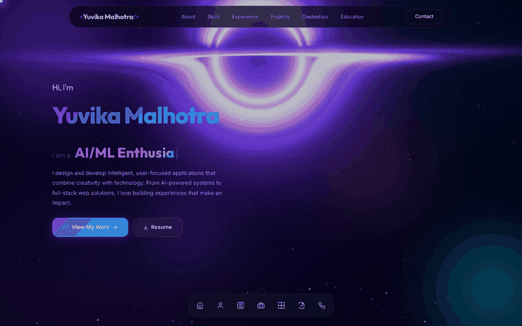
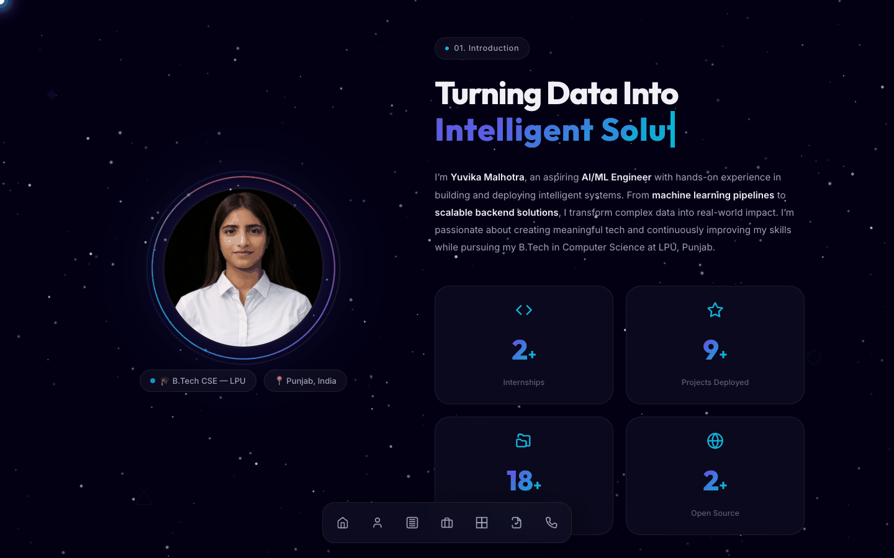
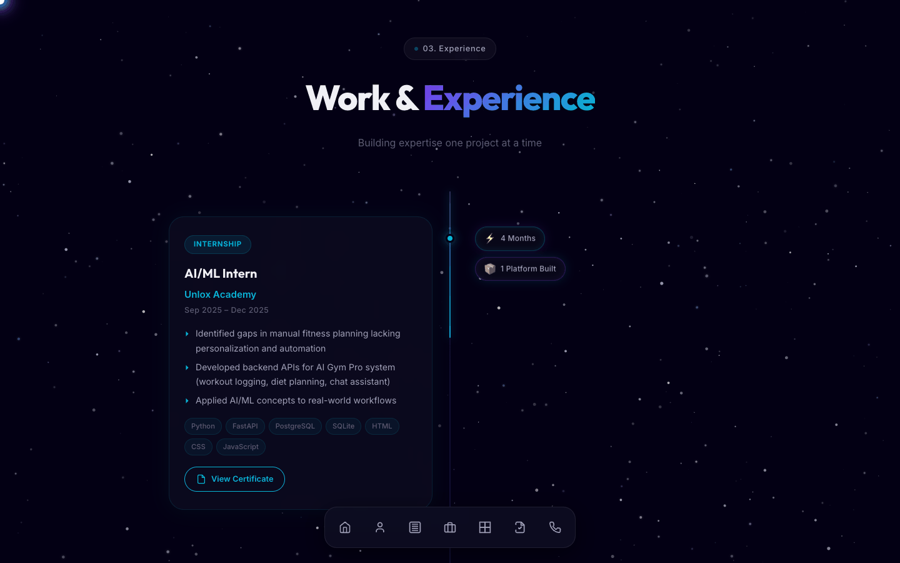
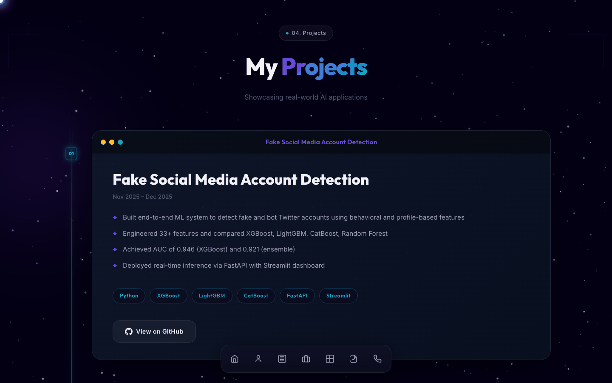
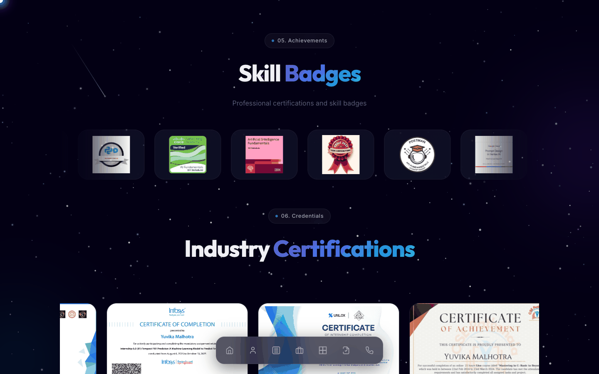
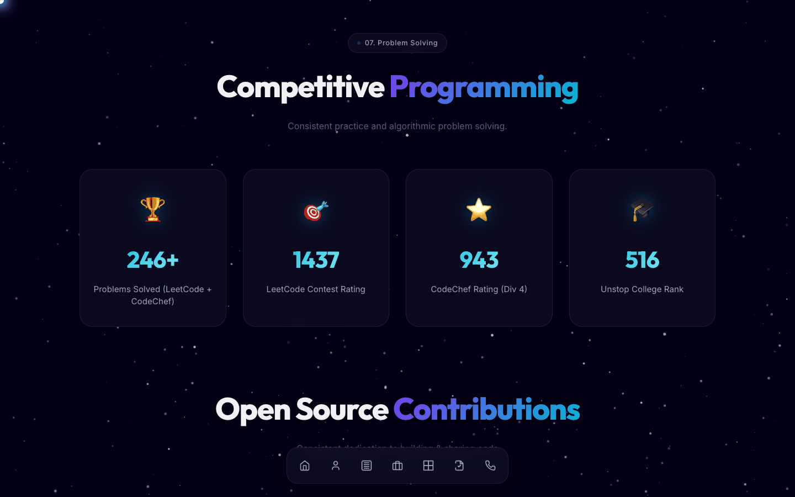
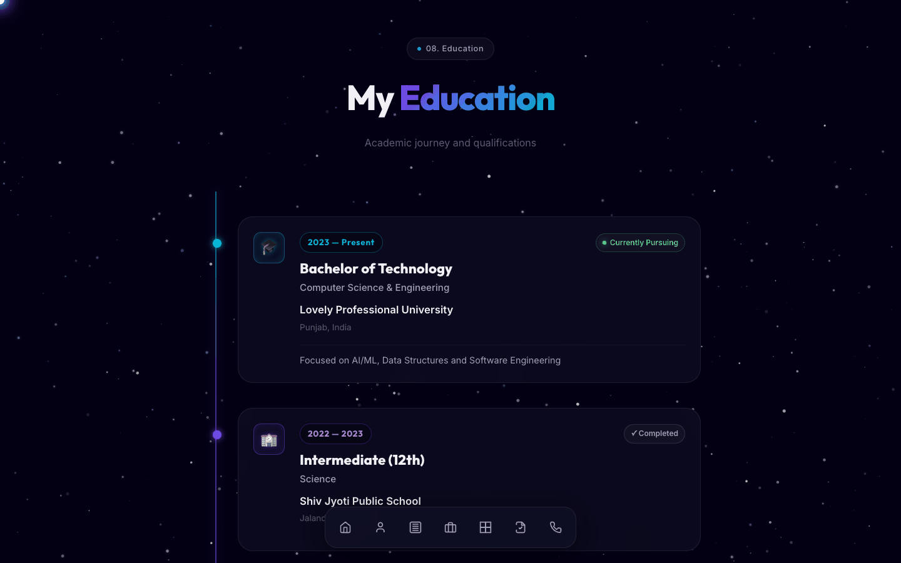

<div align="center">

<a href="https://yuvika.vercel.app">
  
</a>

<br/>

<a href="https://yuvika.vercel.app"></a> <a href="./Yuvika_Malhotra_Resume.pdf"></a>

<br/>

<a href="https://linkedin.com/in/yuvikamalhotra"></a> <a href="https://github.com/Yuvika687"></a> <a href="mailto:yuvikamalhotra1414@gmail.com"></a>    

</div>

<br/>

> Final-year **B.Tech CSE** student at **Lovely Professional University** and an aspiring **AI/ML Engineer** — I build machine-learning pipelines, deploy them behind fast backends, and ship them as products people can use.
> This repo is my personal portfolio: a hand-built, framework-free site with a black-hole hero, live counters, timelines and a certificate gallery.

<br/>

## 🎬 Tour

<div align="center">
  <a href="https://yuvika.vercel.app"></a>
  <sub>Live at <a href="https://yuvika.vercel.app"><b>yuvika.vercel.app</b></a></sub>
</div>

<br/>

## 💼 Experience

| Role | Where | When | Highlights |
|:--|:--|:--|:--|
| **AI/ML Intern** | Unlox Academy | Sep – Dec 2025 | Built backend APIs for the *AI Gym Pro* fitness platform — workout logging, diet planning, chat assistant · Python, FastAPI, PostgreSQL |
| **Intern** | Infosys Springboard 6.0 | Aug – Oct 2025 | Fire Weather Index prediction from meteorological data (PCA, Ridge regression) with a Flask web UI for real-time fire-risk visualisation |
| **AI Trainee** | Unlox Academy | Sep – Dec 2025 | ML fundamentals, data handling and workflow design applied to the AI Gym Pro platform |

## 🚀 Featured projects

| Project | What it does | Stack |
|:--|:--|:--|
| [**CodeShelf**](https://github.com/Yuvika687/CodeShelf) · [▶ live](https://code-shelf-eight.vercel.app) | Spaced-repetition memory engine for developers — AI-generated recall cards, walk mode, offline packs, email recall sprints, Chrome/VS Code extensions | React · FastAPI · PostgreSQL · Gemini |
| [**Anti-Spoof Attendance**](https://github.com/Yuvika687/anti-spoof-attendance) | Mask-aware liveness gate for face attendance — **98.69% accuracy, 1.31% HTER** against photo, replay and 3D-mask attacks, with Grad-CAM explainability | PyTorch · OpenCV · MediaPipe · ONNX |
| [**Fake Social Media Account Detection**](https://github.com/Yuvika687/Fake-twitter-account-detection-using-supervised-ML) | Bot/fake Twitter account detector — 33+ engineered features, **AUC 0.946** (XGBoost), FastAPI inference + Streamlit dashboard | XGBoost · LightGBM · CatBoost · FastAPI |
| [**FWI Weather Predictor**](https://github.com/Yuvika687/FWI-Predictor) | Forest Fire Weather Index regression pipeline with EDA, outlier handling and residual analysis | Pandas · scikit-learn |
| [**AI Gym Pro**](https://github.com/Yuvika687/AI-Personal-Fitness-and-Diet-Coach) | Smart fitness platform — personalised workouts, diet planning and an AI chat coach | Python · FastAPI · JavaScript |

## 🏆 Problem solving & credentials

<div align="center">

| 🏆 **246+** | 🎯 **1437** | ⭐ **943** | 🎓 **516** | 📜 **18+** |
|:--:|:--:|:--:|:--:|:--:|
| problems solved<br/><sub>LeetCode + CodeChef</sub> | LeetCode<br/>contest rating | CodeChef rating<br/><sub>(Div 4)</sub> | Unstop<br/>college rank | certifications<br/>& badges |

</div>

Certifications and badges from **Infosys Springboard**, **Oracle**, **IBM SkillsBuild**, **Google Cloud**, **Cisco Networking Academy**, **Postman**, **freeCodeCamp**, **GSSoC**, **Unstop** and **CSE Pathshala** — viewable in the [credentials section](https://yuvika.vercel.app/#credentials).

<br/>

## 🖼 Inside the site

<table>
  <tr>
    <td width="50%"><p align="center"><b>About</b> — profile, flip-word headline, animated stat counters</p></td>
    <td width="50%"><p align="center"><b>Experience</b> — scroll-drawn timeline with certificates</p></td>
  </tr>
  <tr>
    <td width="50%"><p align="center"><b>Projects</b> — stacked window cards with results &amp; stack</p></td>
    <td width="50%"><p align="center"><b>Credentials</b> — skill badges and certificate gallery</p></td>
  </tr>
  <tr>
    <td width="50%"><p align="center"><b>Problem solving</b> — ratings and contribution map</p></td>
    <td width="50%"><p align="center"><b>Education</b> — academic timeline</p></td>
  </tr>
</table>

<br/>

## 🛠 How it's built

No framework, no build step — **semantic HTML, ~2.5k lines of hand-written CSS and 16 small vanilla-JS modules**, deployed as a static site on Vercel.

| Effect | Module |
|:--|:--|
| Canvas starfield, drifting particles and neural-network backdrop | `stars.js` · `particles.js` · `neural.js` |
| Custom cursor, mouse parallax and 3D card tilt | `cursor.js` · `parallax.js` · `tilt.js` |
| Rotating "I am a …" headline | `flip-words.js` |
| Count-up stats and glowing cards | `counter.js` · `glow-card.js` |
| Scroll-reveal sections and scroll-drawn timelines | `scroll.js` · `timeline.js` · `education-timeline.js` |
| Stacked project cards, interactive globe, certificate gallery | `project-stack.js` · `globe.js` · `certificates.js` |
| Navigation, mobile dock and section wiring | `main.js` |

<details>
<summary><b>Run it locally</b></summary>
<br/>

```bash
git clone https://github.com/Yuvika687/Yuvika-Portfolio.git
cd Yuvika-Portfolio
npx serve .        # or just open index.html in a browser
```

```
Yuvika-Portfolio/
├── index.html               all sections (hero → contact)
├── css/style.css            design system, animations, responsive layout
├── js/                      16 effect modules
├── assets/                  images and icons
├── Badges/ · Certificates/  credential images
├── Experience/              internship certificates (PDF)
└── Yuvika_Malhotra_Resume.pdf
```
</details>

<br/>

<div align="center">

**Yuvika Malhotra** · [yuvika.vercel.app](https://yuvika.vercel.app) · [LinkedIn](https://linkedin.com/in/yuvikamalhotra) · [GitHub](https://github.com/Yuvika687) · [yuvikamalhotra1414@gmail.com](mailto:yuvikamalhotra1414@gmail.com)

<sub>© 2026 Yuvika Malhotra. All rights reserved.</sub>

</div>
